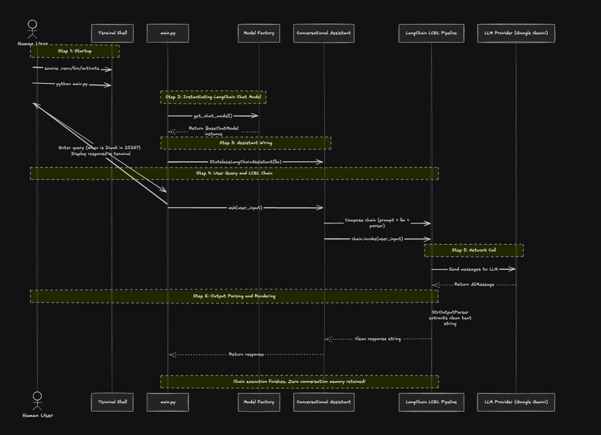
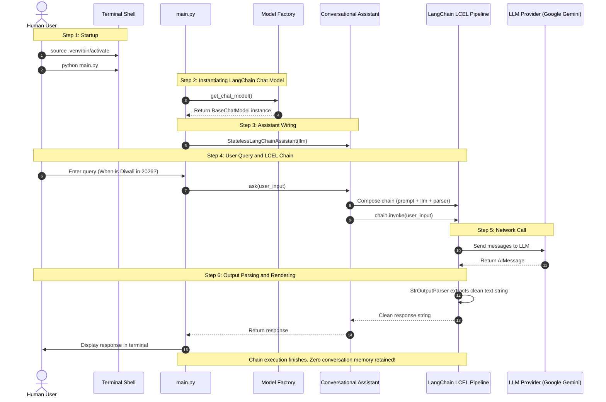

# Architecture Deep-Dive: How the LangChain Conversational AI Assistant Works

A comprehensive technical walkthrough explaining how this assistant works using **standard LangChain (latest version)**, including startup, LangChain Expression Language (LCEL), prompt formatting, model invocation, and output parsing.

---

## 🗺️ LangChain Execution Flowchart



<p align="center">
  
</p>


</details>

---

## 1. The Centralized Model Factory (`llm/model_factory.py`)

To ensure that **changing to any other LLM requires only a few lines in 1 single file**, the project uses LangChain's official built-in **`init_chat_model`** function:

```python
from langchain.chat_models import init_chat_model

return init_chat_model(
    model_name,
    model_provider="google_genai", # or "openai", "anthropic", "ollama"
    **kwargs
)
```

Every other part of the project (prompts, chains, assistant, CLI) depends exclusively on LangChain's generic interface:
```python
from langchain_core.language_models.chat_models import BaseChatModel
```

### Switching Models in 1 File:
To switch between Gemini and OpenAI, you can either:
- Set `LLM_PROVIDER=openai` in `.env` (zero code changes), OR
- Pass `model_provider="openai"` or `"anthropic"` into `init_chat_model()` in [`llm/model_factory.py`](./llm/model_factory.py).

---

## 2. LangChain Expression Language (LCEL) Pipeline

Modern LangChain uses the pipe operator (`|`) to compose standard `Runnable` components into an executable pipeline:

```python
chain = prompt | llm | output_parser
```

### How the Pipeline Executes:
1. **`prompt` (`ChatPromptTemplate`)**:
   - Constructed via [`prompts/builder.py`](./prompts/builder.py).
   - Takes a dictionary input: `{"input": "When is Diwali 2026?"}`.
   - Formats the template into a list of messages: `[SystemMessage(...), HumanMessage(...)]`.
2. **`llm` (`BaseChatModel`)**:
   - Initialized via [`llm/model_factory.py`](./llm/model_factory.py).
   - Receives the message list and sends an authenticated API request to Google or OpenAI.
   - Returns a LangChain `AIMessage` containing text and token metadata.
3. **`output_parser` (`BaseOutputParser`)**:
   - Instantiated via [`parsers/factory.py`](./parsers/factory.py).
   - Receives the `AIMessage` and transforms it into the target type (e.g. `StrOutputParser` yields a string, `PydanticOutputParser` yields a validated Pydantic model).

---

## 3. Why It Is Stateless (Without Preserved Context)

In a typical chatbot, developers wrap chains with a memory buffer:
```python
# Stateful chatbot (NOT used here):
from langchain.memory import ConversationBufferMemory
# This stores every turn and resends history every time!
```

In our **Stateless** assistant:
- **No Memory Object is Attached**: We do not include any memory component in the LCEL chain.
- **Isolated Execution**: When `chain.invoke({"input": user_input})` runs, only the current user input is placed into the prompt.
- **Benefits**:
  - Eliminates context drift or hallucination bleed from earlier queries.
  - Predictable, low token usage.
  - No database or Redis infrastructure required for session persistence.

---

## 4. Modular LangChain Component Architecture

The project cleanly separates logic into dedicated modules:

### [✓] Messages Module (`messages/`)
- [`messages/builder.py`](./messages/builder.py): Contains message creation functions (`create_human_message`, `create_system_message`) and `format_stateless_turn` which assembles an isolated `[SystemMessage, HumanMessage]` list with zero history retention.
- Re-exports `HumanMessage`, `AIMessage`, `SystemMessage` from `langchain_core.messages`.

### [✓] Prompts Module (`prompts/`)
- [`prompts/builder.py`](./prompts/builder.py): Provides `create_chat_prompt` and `create_prompt_with_instructions`.
- [`prompts/library.py`](./prompts/library.py): Contains pre-built LangChain `ChatPromptTemplate` instances (`CONVERSATIONAL_PROMPT`, `CODE_EXPLAINER_PROMPT`, etc.).

### [✓] Parsers Module (`parsers/`)
- [`parsers/factory.py`](./parsers/factory.py): Contains parser instantiation functions:
  - `get_string_parser() -> StrOutputParser`
  - `get_json_parser() -> JsonOutputParser`
  - `get_pydantic_parser(schema) -> PydanticOutputParser`
- Re-exports standard LangChain output parsers from `langchain_core.output_parsers`.

### [✓] Assistant Module (`assistant/`)
- [`assistant/conversational_ai.py`](./assistant/conversational_ai.py): The central orchestrator that imports and coordinates `messages/`, `prompts/`, `parsers/`, and `llm/` into the pure LCEL chain:
  ```python
  chain = active_prompt | self.llm | active_parser
  return chain.invoke({"input": user_input})
  ```

---

## 📁 Project Tree

```
langchain-stateless-ai-assistant/
├── config/
│   └── settings.py               # Credentials & active provider selection
├── llm/
│   ├── model_factory.py          # ⭐ Uses LangChain's official init_chat_model()
│   └── __init__.py
├── messages/
│   ├── builder.py                # Message creation & format_stateless_turn logic
│   └── __init__.py               # Re-exports HumanMessage, AIMessage, SystemMessage
├── prompts/
│   ├── builder.py                # create_chat_prompt & prompt assembly logic
│   ├── library.py                # Predefined LangChain ChatPromptTemplates
│   └── __init__.py
├── parsers/
│   ├── factory.py                # get_string_parser, get_json_parser, get_pydantic_parser
│   └── __init__.py               # Re-exports LangChain Output Parsers
├── assistant/
│   ├── conversational_ai.py      # StatelessLangChainAssistant (orchestrates modules above)
│   └── __init__.py
├── tests/
│   └── test_all.py               # Unit test suite (7 tests passing)
├── architecture_diagram.png      # High-level architecture & sequence diagram
├── demo_all_components.py        # 5-step walkthrough of LangChain components
├── main.py                       # Interactive CLI using LangChain
├── requirements.txt              # Official LangChain dependencies
├── .env.example                  # Template configuration for API keys
├── .gitignore                    # Ensures .env & virtual environment are never committed
├── README.md                     # Project documentation & setup instructions
└── HOW_IT_WORKS.md               # Technical deep dive with architecture diagram
```
